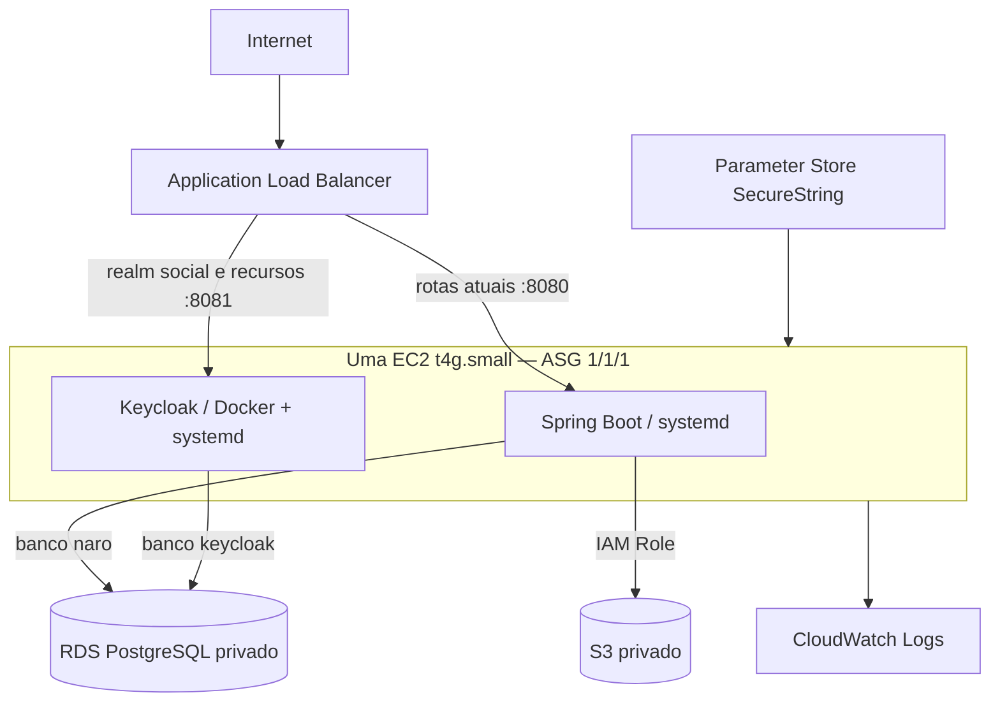
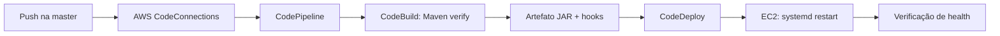

# Naro na AWS — laboratório

Este diretório configura o backend existente em uma infraestrutura pequena, com CDK em Java. O desenvolvimento local continua gratuito, com o Docker Compose da raiz. A região padrão é **us-east-1 (Norte da Virgínia)**, já utilizada no Console da conta e geralmente mais econômica que São Paulo. Não há recursos do projeto distribuídos entre regiões.

## O que foi encontrado no projeto

| Item | Configuração |
|---|---|
| Aplicação | Naro, `com.naro:naro`, backend de rede social |
| Build | Maven Wrapper 3.9.16, Java 25, Spring Boot 4.1.1 |
| Código | `src/main/java/com/naro`, organizado por funcionalidades; Flyway em `src/main/resources/db/migration` |
| HTTP | Porta 8080; APIs em `/api/v1` e `/api/users`, handshake WebSocket `/ws`, Swagger `/swagger-ui.html` |
| Profile original | `local` por padrão; agora também existe `prod` |
| Banco local | PostgreSQL 17, banco `naro`, porta 5432 |
| Identidade local | Keycloak 26.7.3, porta externa 8180; PostgreSQL separado no Compose |
| Realm e clients | Realm `social`; `naro-web` confidencial, Authorization Code + PKCE S256, callback `/api/auth/callback`; `naro-swagger` público PKCE descrito em `docs/api.md` |
| JWT | Resource Server valida issuer e assinatura; roles convertidas pelo código existente |
| Storage | MinIO local; SDK Java 2.x, upload pelo backend e download por URL GET assinada já existentes |
| CORS | Antes só WebSocket tinha origins localhost:3000/127.0.0.1:3000; agora REST também tem lista explícita, separada por profile |
| Health | Não existia Actuator; acrescentado `/actuator/health`, sem detalhes internos |
| GitHub | `leonardovilelaaws-del/naro_back`, branch principal **master** |

As senhas fictícias do Compose continuam somente nas configurações locais e de testes. Secrets de produção nunca reutilizam esses valores. O Compose original não foi substituído nem passou a depender da AWS.

## Arquitetura



A VPC possui duas subnets públicas e duas isoladas. O ALB exige subnets em duas zonas; isso **não cria duas EC2 nem RDS Multi-AZ**. A EC2 única tem IPv4 público para baixar atualizações e acessar APIs AWS, mas seu Security Group aceita somente tráfego vindo do ALB nas portas da aplicação. Não há SSH aberto nem chave SSH.

O RDS fica nas subnets isoladas, sem acesso público, e aceita 5432 somente do Security Group da EC2. O acesso administrativo à máquina usa Systems Manager Session Manager.

**Não há NAT Gateway.** A saída direta da EC2 pelo Internet Gateway evita a cobrança fixa de NAT e de vários VPC endpoints. Não há EKS, ECS, Lambda, Redis, filas, CloudFront ou WAF.

O ASG usa mínimo, desejado e máximo iguais a 1. Créditos de CPU da EC2 ficam em modo Standard para evitar cobrança por créditos ilimitados. O deploy é in-place: há uma pequena indisponibilidade ao reiniciar. Este laboratório não oferece alta disponibilidade. EC2 e RDS ficam na mesma AZ para evitar cobrança entre eles; o ALB mantém as duas subnets exigidas pelo serviço.

## CI/CD



`buildspec.yml` usa Java 25 e executa a suíte Maven, incluindo testes com PostgreSQL e MinIO em containers. Docker privilegiado fica apenas no ambiente efêmero do CodeBuild. O build não recebe secrets de produção nem acesso ao RDS.

`appspec.yml` organiza instalação, parada, inicialização e validação. Os hooks buscam os secrets na própria EC2 usando sua Role. CodeDeploy executa rollback do artefato em falha; isso não reverte migrations Flyway. Migrations devem ser compatíveis com o JAR anterior.

A conexão GitHub usa o aplicativo oficial AWS Connector. Nesta conta reutilizamos `leo-git`, e a instalação foi conferida com acesso somente ao `naro_back`. Durante sua autorização, selecione **Only select repositories → naro_back**. Não use PAT. Uma conexão criada pelo CloudFormation fica pendente até a confirmação no navegador; o CDK não pode autorizar OAuth por você.

O pipeline observa `master`. Mudanças no backend são automáticas; mudanças na própria infraestrutura devem passar por `cdk diff` e `cdk deploy` localmente. Não existe um pipeline adicional de infraestrutura.

## Preparar e implantar

Pré-requisitos: Java 25, Maven ou o wrapper `../mvnw`, Node.js, AWS CDK CLI v2, AWS CLI v2 atual e sessão AWS autorizada. Todos os comandos abaixo partem de `aws/`.

```bash
cd aws
export PATH="$HOME/.local/bin:$PATH"
aws login --profile naro-lab --region us-east-1
export AWS_PROFILE=naro-lab
export AWS_REGION=us-east-1
export CDK_DEFAULT_REGION=us-east-1
export CDK_DEFAULT_ACCOUNT="$(aws sts get-caller-identity --query Account --output text)"
```

`aws login` abre o navegador e usa credenciais temporárias. Faça pessoalmente qualquer autenticação/consentimento. Não crie access keys para a EC2. Se o CDK instalado não reconhecer `login_session`, use o processo oficial do CLI, sem copiar credenciais:

```bash
aws configure set credential_process 'aws configure export-credentials --profile naro-lab --format process' --profile naro-cdk
aws configure set region us-east-1 --profile naro-cdk
export AWS_PROFILE=naro-cdk
# Para deploy, informe também --profile naro-cdk explicitamente.
```

Crie apenas os secrets ausentes. O script valida a conta, gera valores aleatórios na memória, envia por stdin ao CLI e não imprime os valores nem cria arquivos de senhas. Não sobrescreve parâmetros existentes.

```bash
python3 tools/prepare_secrets.py --profile naro-lab --region us-east-1 \
  --account "$CDK_DEFAULT_ACCOUNT" --dry-run
python3 tools/prepare_secrets.py --profile naro-lab --region us-east-1 \
  --account "$CDK_DEFAULT_ACCOUNT"
```

Compile, sintetize e revise antes de implantar:

```bash
mvn clean package
# Sem Maven global (esta máquina): ../mvnw clean package
cdk synth
cdk diff
# Conta atual: reutiliza conexão e Budget, sem duplicar recursos:
cdk diff -c connectionArn=ARN_DA_CONEXAO -c 'existingBudgetName=Passou de 15 dolares'
cdk deploy --profile naro-cdk --no-rollback -c connectionArn=ARN_DA_CONEXAO -c 'existingBudgetName=Passou de 15 dolares'
# Conta nova, sem conexão/Budget prévios:
# cdk deploy --parameters BudgetEmail=SEU_EMAIL
```

**Sempre examine `cdk diff` antes de um deploy importante**, principalmente substituições de RDS, buckets e VPC. Não execute substituições que possam apagar dados sem avaliar o plano. Não é necessário `cdk bootstrap`: esta aplicação não publica assets CDK e utiliza o synthesizer legado, evitando bucket, ECR e roles extras do bootstrap.

Na primeira criação, `--no-rollback` preserva recursos se algo falhar, permitindo corrigir e repetir o deploy sem recriar o RDS. Recursos preservados continuam cobrando; investigue e conclua ou planeje a remoção consciente.

Depois da criação, abra a conexão indicada nos outputs, conclua a autorização do GitHub e confira o estado `AVAILABLE`. Uma execução iniciada antes disso pode falhar no Source; após a autorização, use “Release change” no pipeline ou faça o próximo push na `master`.

Para conservar a seleção dos recursos já existentes em comandos posteriores sem `-c`, use o arquivo local ignorado `cdk.context.json`. Mantenha a chave de availability zones gerada pelo CDK e acrescente uma seleção por conta/região, sem secrets:

```json
{
  "naro:deployment:SUA_CONTA:us-east-1": {
    "connectionArn": "ARN_DA_CONEXAO_EXISTENTE",
    "existingBudgetName": "Passou de 15 dolares"
  }
}
```

O arquivo desta máquina já contém a seleção correta. Num clone novo, restaure-a ou informe os dois `-c` em cada synth/diff/deploy. Não execute `cdk context --clear` sem restaurar essas escolhas. Um override `-c` tem prioridade. A configuração de uma conta/região não é reutilizada em outra.

Exemplo para um domínio que você já possui e um certificado ACM emitido em `us-east-1`:

```bash
cdk diff --profile naro-cdk -c publicHostname=api.SEUDOMINIO \
  -c certificateArn=ARN_DO_CERTIFICADO -c frontendOrigin=https://SEU_FRONTEND
cdk deploy --profile naro-cdk -c publicHostname=api.SEUDOMINIO \
  -c certificateArn=ARN_DO_CERTIFICADO -c frontendOrigin=https://SEU_FRONTEND
```

Conserve esses contextos nas atualizações seguintes. Configure o DNS de seu domínio para o ALB; o stack não cria registros DNS. Sem certificado/hostname, permanece HTTP. A alteração do hostname/issuer exige atualizar a configuração do frontend.

Os parâmetros/contextos e outputs exatos estão no código Java. Valores sensíveis não devem ser fornecidos com `-c`, `cdk.json`, templates ou user-data.

## Secrets e permissões

Todos os parâmetros abaixo são **Standard SecureString**, criptografados pela chave gerenciada `alias/aws/ssm`:

| Caminho | Uso |
|---|---|
| `/naro/prod/database/master-password` | Bootstrap das duas bases e usuários |
| `/naro/prod/database/password` | Usuário `naro_app` usado pelo Spring |
| `/naro/prod/keycloak/db-password` | Usuário `keycloak` |
| `/naro/prod/keycloak/admin-password` | Administração inicial do Keycloak |
| `/naro/prod/keycloak/client-secret` | Client confidencial `naro-web`, para o servidor do frontend |

O backend nunca usa a senha administrativa do Keycloak ou o client secret. Eles não são enviados ao browser. A criação inicial usa o usuário RDS `naro_admin`; os serviços operam com usuários próprios.

Os arquivos de ambiente gerados ficam na EC2 em `/etc/naro`, com acesso restrito a root; não entram no artefato nem no Git. Não execute `set -x`, não imprima esses arquivos e não copie saídas contendo secrets para issues ou logs. A senha bootstrap do Keycloak só cria a conta inicial; alterar o parâmetro não troca automaticamente a senha de um administrador já existente.

Há Roles separadas para EC2, CodeBuild, CodeDeploy e CodePipeline. A Role EC2 permite operações de objetos somente no bucket do projeto, leitura apenas dos cinco parâmetros, logs e comunicação SSM. Algumas APIs de comunicação/descoberta dos serviços AWS exigem `Resource: *`; isso não equivale a `Action: *` ou AdministratorAccess.

Não versione `.env*`, credenciais AWS, chaves privadas, dumps com dados/segredos, `cdk.out`, `target`, logs ou configurações privadas da IDE. O `.gitignore` cobre esses arquivos. Antes de commit/push, confira `git status`, `git diff --cached` e faça uma busca de secrets. Credenciais fictícias dos testes não devem ser confundidas com secrets reais.

## Keycloak

Roda em Docker na mesma EC2, gerenciado por `naro-keycloak.service`, versão 26.7.3. A porta da aplicação é 8081, com prefixo `/auth`; a gestão/health usa 9000 e não é encaminhada publicamente pelo ALB. O health check é `/health/ready`.

Usa o mesmo RDS, mas banco e usuário `keycloak`. O setup preserva realm `social`, tema Naro, client confidencial `naro-web` e PKCE. O client `naro-swagger` usa PKCE público e callback exato do Swagger. Redirect URLs e Web Origins não usam `*`.

O issuer é `PUBLIC_ORIGIN/auth/realms/social`. Spring valida esse issuer público e busca o JWKS diretamente em `127.0.0.1:8081`, evitando uma volta pelo ALB. `KC_PROXY_HEADERS=xforwarded` aceita os headers do ALB; o hostname é fixo, não derivado livremente de headers de entrada. O profile Spring configura forwarded headers para que links HAL preservem host/esquema.

Sem domínio, HTTP é permitido apenas para os testes do laboratório. Não use senhas ou dados reais nessa condição. Para uso real, informe um certificado ACM da mesma região e um hostname do seu domínio; configure DNS para o ALB. Não compramos domínio nem criamos Route 53.

O ALB bloqueia a administração e o realm `master` publicamente. Para utilizar o Admin Console, instale o Session Manager plugin oficial e abra um túnel autenticado:

```bash
aws ssm start-session --target ID_DA_EC2 --region us-east-1 \
  --document-name AWS-StartPortForwardingSession \
  --parameters '{"portNumber":["8081"],"localPortNumber":["18081"]}'
```

Abra `http://localhost:18081/auth/admin/master/console/`. O usuário inicial é `naro-admin`. Consulte sua senha diretamente no Parameter Store autenticado; não a copie para comandos/histórico. `KC_HOSTNAME_ADMIN` e o frontend URL do realm `master` apontam para localhost18081, mantendo o login dentro do túnel. O issuer de `social` continua público. Não há regra de acesso administrativo aberta no ALB.

```bash
sudo systemctl status naro-keycloak
sudo systemctl restart naro-keycloak
sudo systemctl restart naro-backend
sudo tail -n 80 /var/log/naro/keycloak.log
sudo tail -n 80 /var/log/naro/backend.log
```

O frontend é um projeto separado e não é publicado por este stack. A origem padrão para testá-lo continua `http://localhost:3000`; configure sua origem real antes de testar login de outro endereço. O servidor do frontend precisa receber issuer/client ID/client secret de produção por um meio seguro, nunca em variáveis públicas do browser.

## S3

O bucket de publicações é privado, com Block Public Access, SSE-S3 e exigência de TLS. Sem versionamento, replicação, aceleração ou CloudFront. O SDK Java 2.x usa `S3Client` e `S3Presigner` com a cadeia padrão de credentials, que na EC2 encontra a Instance Profile.

Uploads continuam passando pelo backend, limitados a 10 MB. Downloads usam URLs assinadas com duração de 30 minutos: quem recebe essa URL consegue ler o objeto durante sua validade. Não há alteração geral de APIs para implementar PUT assinado.

Localmente, o endpoint aponta para MinIO e utiliza as credenciais fictícias do Compose. Em produção, não há endpoint customizado nem access key; o bucket é criado pelo CDK e a aplicação não recebe permissão para criar buckets.

Existe um segundo bucket privado para os artefatos obrigatórios do CodePipeline, para guardar revisões de deploy. Ele não duplica o storage de publicações; guarda os pacotes de deploy. Não há expiração automática da última revisão: a reposição da EC2 pelo ASG depende dela. Limpe revisões antigas manualmente, preservando a última execução bem-sucedida e uma versão de rollback.

## Desenvolvimento local

Na raiz do repositório:

```bash
docker compose -f docker-compose.dev.yml up -d
./mvnw spring-boot:run
# local é o profile padrão; também pode informar SPRING_PROFILES_ACTIVE=local
./mvnw clean verify
curl http://localhost:8080/actuator/health
curl http://localhost:8180/realms/social/.well-known/openid-configuration
curl http://localhost:9000/minio/health/live
```

O setup original do Keycloak continua em `scripts/keycloak-setup.sh`. Ele sincroniza o secret com o frontend local usando o script existente. Não o execute contra o Keycloak de produção.

Variáveis locais existentes incluem `KEYCLOAK_ADMIN`, `KEYCLOAK_ADMIN_PASSWORD`, `NARO_REALM`, `NARO_CLIENT_ID`, `NARO_APP_URL`, `NARO_FRONTEND_DIR` e as opções SMTP documentadas em `docs/registration.md`. Em produção, os hooks fornecem `DATABASE_URL`, `DATABASE_USERNAME`, `DATABASE_PASSWORD`, `KEYCLOAK_ISSUER_URI`, `KEYCLOAK_JWK_SET_URI`, `AWS_REGION`, `S3_BUCKET`, `CORS_ALLOWED_ORIGINS` e `SPRING_PROFILES_ACTIVE=prod`.

## Operação e diagnóstico

1. Source falhou: confira conexão `AVAILABLE`, repository selecionado e branch `master`.
2. Build falhou: abra CodeBuild → build → CloudWatch Logs; confira relatórios Maven e Docker/Testcontainers.
3. Deploy falhou: abra CodeDeploy → deployment → eventos por instância. Na EC2, veja `/var/log/aws/codedeploy-agent` e os logs dos hooks.
4. Target unhealthy: verifique `systemctl status`, logs, acesso ao Parameter Store e conexão RDS. Spring deve responder `{"status":"UP"}` em 8080; Keycloak deve estar pronto em 9000.
5. JWT recusado: compare issuer do token com o issuer público, realm e relógio da máquina. Não substitua validação de assinatura por confiança no frontend.

CloudWatch guarda logs por sete dias. Logs locais têm rotação. Métricas/monitoramento pagos adicionais não foram adicionados. Nunca habilite `/actuator/env` ou detalhes de health publicamente.

## Serviços, em poucas palavras

| Serviço/conceito | Para que serve aqui |
|---|---|
| VPC | Rede privada dos recursos |
| Subnet | Parte da rede, pública ou isolada |
| Security Group | Firewall entre ALB, EC2 e RDS |
| IAM | Define quem pode fazer quais operações |
| IAM Role | Credenciais temporárias para um serviço, sem chaves no código |
| EC2 | Máquina que executa Spring e Keycloak |
| Auto Scaling Group | Mantém a única máquina; máximo permanece 1 |
| ALB | Entrada HTTP/HTTPS e roteamento por caminho |
| Target Group | Destino/porta e health check do ALB |
| RDS | PostgreSQL gerenciado, privado e Single-AZ |
| S3 | Objetos privados e artefatos de deploy |
| Parameter Store | Secrets criptografados de baixo custo |
| CodeConnections | Integração oficial entre GitHub e AWS |
| CodePipeline | Orquestra Source, Build e Deploy |
| CodeBuild | Compila e testa o Java em ambiente temporário |
| CodeDeploy | Entrega o JAR e executa hooks na EC2 |
| CloudWatch | Logs e métricas básicas da AWS |
| Systems Manager | Acesso à EC2 sem SSH público |
| AWS Budget | Alertas de gasto; não bloqueia cobrança |
| CDK | Descreve infraestrutura usando Java |
| CloudFormation | Cria e atualiza os recursos a partir do template gerado |

## Custos e encerramento

Este laboratório **não é gratuito**. Nesta conta, reutilizamos o Budget existente **“Passou de 15 dolares” (US$ 15/mês)**, que já possui alertas por e-mail de gasto real e previsto. Em uma conta nova, o CDK cria um Budget de US$ 25/mês. Esse é um alerta baixo para estudo, não uma promessa de que todos os recursos ligados 24h/dia caberão nesse valor. Alertas não desligam nada e podem chegar com atraso. Não conte com Free Tier/créditos sem verificar sua conta.

| Recurso | O que gera cobrança |
|---|---|
| ALB | Horas ligado e capacidade LCU utilizada, mesmo com pouco tráfego |
| EC2 t4g.small | Tempo ligado; sem créditos de CPU Unlimited |
| EBS | Disco gp3 de 20 GiB, independente do uso dentro dele |
| RDS db.t4g.micro | Tempo ligado, armazenamento gp3 de 20 GiB e eventual excesso de backup/créditos de CPU |
| IPv4 público | Endereços do ALB (ao menos dois) e da EC2 |
| S3 | Dados, requests e downloads; artefatos antigos podem ser limpos manualmente, preservando a revisão ativa |
| CodeBuild | Minutos de build/testes; limite de concorrência e timeout evitam builds sem fim |
| CodePipeline | Pipeline ativo, conforme tabela do tipo V1 |
| CloudWatch | Ingestão e armazenamento de logs, retenção de sete dias |
| Transferência | Saída para internet e eventual tráfego entre zonas |

Preços consultados pela API oficial AWS Pricing em 26/09/2026, sem Free Tier, impostos ou descontos, usando 730 horas/mês:

| Item | us-east-1 | sa-east-1 |
|---|---:|---:|
| EC2 t4g.small | US$ 0,0168/h ≈ 12,26/mês | US$ 0,0268/h ≈ 19,56/mês |
| RDS db.t4g.micro | US$ 0,016/h ≈ 11,68/mês | US$ 0,034/h ≈ 24,82/mês |
| ALB fixo | US$ 0,0225/h ≈ 16,43/mês | US$ 0,034/h ≈ 24,82/mês |
| Soma desses três | **US$ 40,37/mês** | **US$ 69,20/mês** |

Incluindo cerca de três IPv4, discos e uso leve, reserve aproximadamente **US$ 55–65/mês em us-east-1**; tráfego, LCU, builds, logs e impostos variam. O laboratório ligado poucos dias custa proporcionalmente menos nos itens por hora. Esta estimativa não é um teto de cobrança.

Sem NAT, Multi-AZ RDS, replicas, chave KMS própria, Secrets Manager ou monitoramento premium. ALB, EC2 e RDS são os principais custos fixos. Desligar somente a EC2 não interrompe a cobrança dos demais recursos. O próprio RDS pode ser reiniciado automaticamente pela AWS depois de uma parada temporária.

Quando terminar seus testes, planeje destruir a infraestrutura para parar as cobranças:

```bash
cd aws
cdk diff
cdk destroy
```

**Esse comando remove infraestrutura e interrompe a aplicação. Revise e confirme conscientemente; não o execute automaticamente.** O RDS gera snapshot final e os buckets são retidos para evitar perda silenciosa de dados. Snapshots, buckets e parâmetros podem continuar existindo/cobrando após `destroy`; confira os recursos restantes e só os apague depois de decidir que os dados não são necessários. Buckets retidos, mesmo vazios, impedem recriação com os mesmos nomes: planeje importação/reuso ou limpeza explícita, sem apagar automaticamente.

## Referências oficiais

- [CDK e CloudFormation](https://docs.aws.amazon.com/cdk/v2/guide/home.html)
- [CodeConnections com GitHub](https://docs.aws.amazon.com/codepipeline/latest/userguide/connections-github.html)
- [Java 25 no CodeBuild](https://docs.aws.amazon.com/codebuild/latest/userguide/available-runtimes.html)
- [Credenciais temporárias com AWS CLI](https://docs.aws.amazon.com/cli/latest/userguide/cli-configure-sign-in.html)
- [Keycloak atrás de proxy](https://www.keycloak.org/server/reverseproxy)
- [Health do Keycloak](https://www.keycloak.org/observability/health)
- [Preços EC2](https://aws.amazon.com/ec2/pricing/on-demand/), [ALB](https://aws.amazon.com/elasticloadbalancing/pricing/), [RDS PostgreSQL](https://aws.amazon.com/rds/postgresql/pricing/), [IPv4](https://aws.amazon.com/vpc/pricing/)

## Arquivos e validação

- `src/main/java/com/naro/aws`: aplicação e stack CDK; testes de infraestrutura em `src/test`.
- `../buildspec.yml`, `../appspec.yml`: build AWS e ciclo de deploy.
- `scripts/`: empacotamento, configuração de runtime/banco, hooks e testes.
- `systemd/`: serviços Spring/Keycloak e logrotate.
- `keycloak/configure.py`: realm, clients e acesso administrativo via túnel.
- `tools/prepare_secrets.py`: criação segura de parâmetros ausentes.
- `../.gitleaks.toml`: ignora somente um falso positivo exato do endpoint JDBC local; mantém demais regras de detecção.

Validação local: 326 testes Maven passaram sem falhas/skips; PostgreSQL e MinIO reais via Testcontainers; smoke do JAR local e descoberta Keycloak local passaram. Runtime ARM foi testado isoladamente com PostgreSQL17/Keycloak26.7.3, incluindo configuração idempotente e login administrativo. Consulte `VALIDATION.md` para o resultado real do deploy AWS.

Recursos anteriores da conta, como stacks antigas do Elastic Beanstalk e buckets de outros estudos, não pertencem ao NaroLab e não foram apagados. A conexão e o Budget reutilizados também permanecem fora do ciclo de destruição do stack.

O teste manual completo roda pela EC2/SSM como root:

```bash
python3 /opt/naro/deployment/aws/tools/smoke_application.py
```

Ele cria um usuário/client de diagnóstico exclusivo, um canal e uma publicação com imagem de um pixel. Verifica JWT, RDS, upload pelo backend, download por URL assinada e negação de acesso anônimo ao S3. Ao terminar desabilita o usuário/client e encerra suas sessões, sem apagar dados existentes. Reexecuções na mesma EC2 reutilizam os IDs em `/var/lib/naro/smoke-state.json` (0600), que não contém senhas/tokens. Uma nova EC2 cria seu próprio diagnóstico; não execute esse teste em loop.
